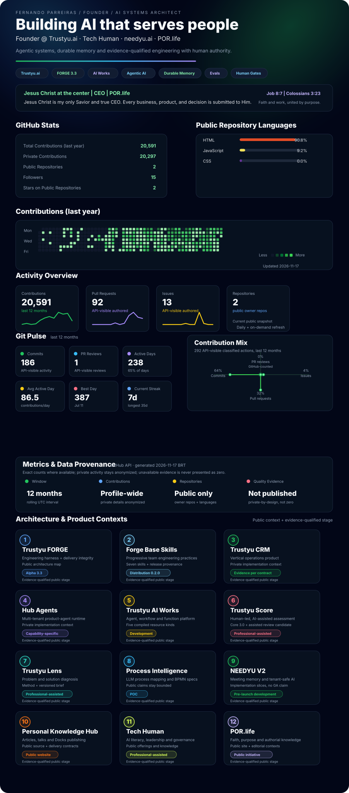

<div align="center">



<br />
<br />

[](https://fernandoparreiras.com.br)
[](https://trustyu.ai)
[](https://forge.trustyu.ai)
[](https://por.life)
[](https://techhuman.com.br)
[](https://www.linkedin.com/in/fernandoparreiras)

</div>

---

# Fernando Parreiras

**Founder · AI systems architect · Builder of human-centered technology**

I turn complex business problems into practical AI products and operating systems. My work combines product strategy, software architecture, agentic systems, durable context, governance, and hands-on delivery across [Trustyu.ai](https://trustyu.ai), [Trustyu Forge](https://forge.trustyu.ai), [Tech Human](https://techhuman.com.br), [needyu.ai](https://needyu.ai), and [POR.life](https://por.life).

## GitHub activity

<!-- profile-metrics:start -->
Updated **2026-11-16** · [exact UTC window and JSON](assets/profile-metrics.json) · daily refresh at **07:17 America/Sao_Paulo**.

| Rolling 12-month activity | Count |
| --- | ---: |
| Profile contributions | 20,515 |
| Anonymized private contributions | 20,226 |
| API-visible commits | 183 |
| API-visible authored pull requests | 90 |
| API-visible authored issues | 13 |
| API-visible formal PR reviews | 1 |
| Active days | 237 |
| Current / longest streak | 6 / 35 days |
| Public owner repositories / stars | 2 / 2 |
| Followers | 15 |

Private activity is aggregated; the API-visible breakdown does not classify all private contributions. Counts include eligible automated activity and do not measure human effort or product readiness. [Methodology and limitations](docs/profile-metrics-methodology.md).
<!-- profile-metrics:end -->

## Start Here

| Destination | What you will find |
| --- | --- |
| [Personal website](https://fernandoparreiras.com.br) | Advisory, talks, case studies, businesses, books, articles, and ways to work together |
| [Knowledge & articles](https://fernandoparreiras.com.br/artigos/) | Source-controlled essays on leadership, business, careers, and AI, with static delivery and RSS |
| [Talks & Docks](https://fernandoparreiras.com.br/docks/) | Public presentations, speaker notes, downloadable materials, and practical follow-up paths |
| [Website source](https://github.com/fernandoparreiras/fernandoparreiras-website) | React/Vite implementation, publishing systems, delivery controls, and technical documentation |
| [Trustyu.ai](https://trustyu.ai) | A B2B AI Native solutions accelerator spanning discovery, assessment, engineering, and qualified execution |
| [Trustyu Forge](https://forge.trustyu.ai) | The human-directed engineering harness around AI-assisted software delivery |
| [Public AI architecture map](docs/trustyu-ai-architecture.md) | Evidence-qualified detail on Forge, AI Works, Hub Agents, LLM routing, durable memory, evals, Jev, Score, and safety boundaries |
| [Metrics methodology](docs/profile-metrics-methodology.md) | Sources, definitions, refresh policy, limitations, and the boundary between public counts and private engineering evidence |
| [Machine-readable metrics](assets/profile-metrics.json) | Exact generated values behind the dashboard, with the measurement window and scope recorded alongside them |
| [needyu.ai](https://needyu.ai) | Meeting memory, context infrastructure, and human-centered AI assistance |
| [Tech Human](https://techhuman.com.br) | AI literacy, leadership, governance readiness, and humanized transformation |
| [POR.life](https://por.life) | The faith-led foundation connecting purpose, ethics, work, and impact |

Most product engineering lives in organization and private repositories. This profile publishes a redacted technical map, not private code, credentials, customer data, internal topology, or unverified commercial claims.

### Evidence language used here

| Term | Meaning |
| --- | --- |
| **Implemented** | Code or an executable contract exists in the stated scope. |
| **Verified** | It passed declared checks for a specific version and environment. |
| **Operating** | A qualified slice has an explicit owner, support model, and operating boundary. |
| **Professional-assisted** | Specialists use software and AI; human review remains authoritative. |
| **Development / Alpha / POC / Research** | Work exists, but availability, scale, adoption, and outcomes are not implied. |

Implementation, verification, merge, deployment, public behavior, operation, and outcomes are separate gates.

## Now — 16 November 2026

- **Trustyu Forge:** the current framework is **3.3 Alpha**. Progressive team adoption and verifiable synchronization are the focus of the **3.4 proposal**, which has its own approval and qualification gates. The three-layer canonical/distribution/client-delivery model also remains proposed.
- **Forge Base:** distribution **0.2.0** provides seven engineering skills, with canonical derivation, reproducible builds, versioned provenance, team feedback, and synchronization checks. Framework, runtime, template, plugin, installation, and actual use have independent versions and evidence.
- **Trustyu AI Works:** creation, evolution, modernization, and composition of AI Native solutions; 12 modeled resource kinds and qualified compiled paths for Agent, Function, Workflow, Widget, and Surface. Current work includes durable assistant coordination, authoring consistency, browser-assisted investigation, and explicit solution-acceptance contracts.
- **Trustyu Score:** approved deterministic **Core 3.0.0** and editorial standard **4.1.0** remain authoritative. A **3.0.1 assisted-review candidate** adds coverage obligations, evidence grounding, revision integrity, decision records, receipts, and replay. Runtime activation and candidate promotion retain their own gates.
- **NEEDYU V2:** pre-launch meeting memory with web, API, worker, a Chrome companion, and local ASR. Engineering covers consented capture, transcription/diarization, temporal memory, post-call handling, sharing, tenant-safe assistance, and recoverable background work. V1 repositories preserve historical code separately.
- **Public knowledge:** the personal hub connects articles, RSS, Docks presentations, advisory, talks, and consent-based follow-up; Tech Human and POR.life provide the broader leadership, learning, and purpose contexts.

This status cut is dated **2026-11-16**, following a targeted review of current default-branch documentation and recent engineering handoffs. It publishes a redacted capability map; customer material, credentials, private topology, and unverified outcomes remain outside this profile.

My role combines founding direction, product conception, frontend/UX, architecture-to-business decisions, and delivery review. AI Works engineering and architecture are led by Samuel Cardoso; Forge Base maintenance and team adoption are led by Diego. Contributions are collaborative, and AI-assisted work retains its provenance.

## Faith, Work, and Purpose

I am a Christian. I believe Jesus Christ is my only Savior, the center of my life, my family, and the work I build.

Through [POR.life](https://por.life), every business and initiative I lead is aligned with a simple conviction: Jesus is at the center. He is the true CEO over purpose, strategy, execution, ethics, people, and impact.

> Though thy beginning was small, yet thy latter end should greatly increase.
>
> **Job 8:7**

> And whatsoever ye do, do it heartily, as to the Lord, and not unto men.
>
> **Colossians 3:23**

---

## Platform Stack

These are technologies used across different Trustyu, Tech Human, NEEDYU, and personal systems. Product-specific ADRs may override Foundation defaults; no single repository is claimed to use every badge.

### Product Foundation


### Backend, Data, and Durable Runtime


### Cloud, Runtime Isolation, and Delivery


### AI, Agents, and Evaluation


### AI Works — Orchestration, Decisions, Contracts, and Data

Additional technologies verified in the AI Works dependency manifests, runtime documentation, and infrastructure definitions on **2026-11-16**. These complement the cross-product stack above; the [AI Works technology map](docs/aiworks-technology-map.md) explains each role and its usage boundary.

[](https://temporal.io/)


### Quality and Security


---

## Trustyu: Discovery, Assessment, Engineering, and Execution

[Trustyu.ai](https://trustyu.ai) is a B2B AI Native solutions accelerator invested in by Tech Human. Its current product map keeps method, runtime, maturity, and commercial availability explicit.

| Capability | What it does | Public status cut |
| --- | --- | --- |
| **Trustyu Lens** | Clarifies the problem, buyer, alternatives, evidence, hypotheses, and next validation through a versioned `SolutionBrief` | **Professional-assisted**; methodology/skill, not a SaaS claim |
| **Trustyu Score** | Assesses existing and AI-built systems across Technical, Product, and Market tracks | **Professional-assisted**; deterministic Core 3.0.0 + report standard 4.1.0 + human review |
| [**Trustyu Forge**](https://forge.trustyu.ai) | Governs AI-assisted engineering from intent and architecture through evidence and human verdict | **FORGE 3.3 Alpha**; adoption and `Operating` are qualified separately |
| **Trustyu AI Works** | Models 12 resource kinds and provides qualified build/publication paths for Agent, Function, Workflow, Widget, and Surface | **Development**; generic Git Code Ops, operational-pilot completion, public scale, self-service, and GA are not claimed |
| **Hub Agents** | Multi-tenant runtime for product agents and vertical workflows | **Capability-specific**; active slices do not prove every planned integration |
| **Process Intelligence** | Explores LLM-assisted process mapping, BPMN, and technical process specifications | **POC**; product stack and operation are not inferred |

Lens, Score, Forge, and AI Works are complementary entry points, not a mandatory purchase sequence.

## Trustyu Forge — Engineering Harness

[Trustyu Forge](https://forge.trustyu.ai) is the human-directed engineering harness around AI-assisted delivery. It does not promise that generated code becomes production software automatically. It makes intent, context, execution, verification, evidence, authority, and outcomes traceable.

```text
SPEC → EXPLORE → PLAN → RED → IMPLEMENT → GREEN → SELF-VERIFY → PR
                                                               ↓
                  LEARN ← ROLLBACK/ADAPT ← OBSERVE ← READBACK ← RELEASE
```

| Harness layer | Public description |
| --- | --- |
| Knowledge and intent | Versioned ADRs, specifications, standards, runbooks, skills, and release contracts |
| Isolated execution | Named ownership, branches/worktrees, task sandboxes, capability boundaries, and least privilege |
| Verification | Contract-first tests, affected checks, smoke tests, SAST, CVE/secret gates, evals, and independent evidence |
| Provenance | Source-bound subjects, artifact identity, receipts, evidence bundles, and explicit limitations |
| Governance | Risk-proportional profiles, gate lifecycle, scoped overrides, rollback, and human verdicts |
| Delivery integrity | CI, merge, deployment, public behavior, operation, and outcome remain separate states |
| Learning | Measured reliability, cost, failure modes, and durable feedback without invented productivity multipliers |

FORGE 3.2 adds Brownfield & Consolidation for systems that must be preserved, integrated, redesigned, or retired. FORGE 3.3 adds verifiable governance and delivery integrity. The current integrated program is Alpha; each mechanism carries its own implementation, verification, and operating evidence. A proposed three-layer boundary — canonical framework, versioned distribution, and client-scoped delivery — remains explicitly proposed until its final architectural approval.

The team distribution, **Forge Base 0.2.0**, packages seven practices: context routing, specifications, planning in slices, testing with proof, commits/PRs, responding to reviews, and recording decisions. Changes flow from canonical sources through review, validation, release, installation, and a verified project task. Local project rules and authorized context remain part of the work. **FORGE 3.4 is a proposal for progressive adoption and verifiable synchronization.**

## AI Architecture

### Agentic systems and workflows

- **Hub Agents:** Python, FastAPI, Clean Architecture, LangGraph, PostgreSQL/pgvector, Redis/Arq, tenant isolation, pluggable channels, and product-specific personas and tools.
- **AI Works:** TypeScript/Fastify control and data planes, Next.js authoring, Temporal durable supervision, Go/Zigflow workflow execution, and workerd-isolated Functions. Twelve resource kinds are modeled; five currently have compiled artifact build/publication paths.
- **NEEDYU V2:** Next.js/Fastify/worker services, a Manifest V3 companion, and Python/FastAPI ASR with sherpa-onnx; PostgreSQL holds authoritative records and jobs/outbox, while Redis Streams carries notifications.
- **Compiled contracts:** Agents and Workflows become versioned `openworkflow/v1` artifacts; Functions execute exact immutable targets with authorization and policy revalidation.
- **Control and execution:** Forge governs intent, risk, evidence, states, and authority; AI Works provides qualified execution surfaces. Their composition is architectural direction, not a universal operating claim.
- **Effects:** idempotency keys, tool journals, approvals, and effect receipts make retries explicit; uncertain external effects stop for reconciliation.
- **Human authority:** a model can propose or execute within policy, but external, irreversible, and production decisions remain with an authorized person.

### LLM model strategy

Trustyu does not relabel third-party foundation models as proprietary models. The architectural asset is governed selection and routing:

- Hub Agents uses an `LLMFactory` to route by use case and capability;
- AI Works maintains product-specific model registries, provider protocols, and frozen run policies;
- Anthropic, OpenAI, and Google models can be compared for different tasks;
- promotion considers eval quality, latency, cost, data risk, fallback, and observability;
- model IDs stay in product authorities instead of drifting across documentation;
- a provider listed here is not automatically enabled for every product, tenant, or dataset.

### Durable memory and context

Durable memory is governed evidence, not an unlimited transcript dump:

- authoritative records are separated from rebuildable full-text/vector indexes;
- writes are idempotent and coordinated by durable workflows;
- retrieval is permission-revalidated, bounded, and purpose-aware;
- claims preserve provenance, confidence, limitations, feedback, and invalidation paths;
- content-addressed artifacts and explicit heads prevent silent replacement;
- retention and purge are storage contracts;
- private recovered content is not copied into logs or durable traces by default.

AI Works platform memory and NEEDYU context/memory explorations remain separate bounded contexts. Similar concepts do not imply a single shared production service.

### Evaluations, typed decisions, and Jev

- Evals pin the candidate, dataset, harness, judge, rubric, and policy snapshot.
- Online observations and offline evaluation executions remain distinct.
- Missing evidence or an unavailable judge does not silently become approval.
- Overrides require scoped authority and remain auditable.
- Typed decision ports constrain a responder to declared options instead of granting open system authority.
- **Jev** is an external typed-decision responder used in scoped, policy-gated and shadow-mode flows. Its use depends on consent, data minimization, fallback, frozen policy, and provenance; it is not a universal runtime dependency.

### Trustyu Score

Trustyu Score is currently **human-led and AI-assisted**, not an autonomous auditor. Its deterministic Core v3 supports:

- a 0–100 technical score across four dimensions and eleven pillars;
- explicit `unknown` and `not_observed` states instead of turning missing evidence into zero;
- safety caps and applicable-coverage requirements;
- three report tracks: Technical, Product, and Market;
- typed evidence, risks, impact, priorities, limitations, and remediation roadmaps;
- an approved 4.1.0 editorial/layout standard for new manual HTML/PDF emissions across all three report perspectives;
- a fixture-only navigable BETA journey used to review the engagement flow without claiming a production portal, real authorization, billing, tenant isolation, or client execution.

The integrated assisted-review candidate adds a question-based coverage plan, evidence grounding, revision/dependency checks, explicit dispositions, and Core receipt/replay. It makes missing or inconsistent records detectable in the exercised contracts. Semantic sufficiency, calibration, candidate promotion, and AI Works integration require their own reviews. Each new report edition carries a shared HTML/PDF identity and a recorded reading-completion time.

The target source-bound runtime, specialized product agents, Evidence Plane, and client portal remain review-gated. No claim of scientific validation, certification, autonomous availability, or FORGE attestation is made here.

Read the [full public architecture map](docs/trustyu-ai-architecture.md) for the detailed product, runtime, memory, evaluation, stack, and disclosure boundaries.

## Multi-Agent Engineering Model

I use AI agents as a bounded execution layer:

- repository instructions and ADRs keep decisions outside transient chat memory;
- one task, one owner, one branch/worktree, and explicit handoffs reduce collisions;
- contract-first RED/GREEN/VERIFY cycles make progress reviewable;
- model output, test result, reviewer signal, merge, deploy, and operation are distinct;
- human and AI review signals complement rather than replace engineering judgment;
- tools and egress follow capability boundaries and least privilege;
- privacy-safe traces make agent behavior debuggable without logging customer content;
- secrets, customer evidence, and private topology remain outside the public profile.

## Stack Philosophy

| Context | Stack and boundary |
| --- | --- |
| Foundation products | Next.js 16, React, TypeScript strict, Tailwind, shadcn/ui, Prisma, pnpm 11, i18n, Vitest |
| Hub Agents | Python 3.12+, FastAPI, Pydantic, SQLAlchemy/Alembic, LangGraph, Arq, PostgreSQL 18 + pgvector, Redis 8.2.x |
| AI Works | Node.js 26+, pnpm 11.22, TypeScript, Fastify, Next.js, Temporal, Go/Zigflow, workerd, Kubernetes/Minikube, AWS EKS, object storage |
| NEEDYU V2 | Node.js 24, Next.js, Fastify, PostgreSQL jobs/outbox, Redis Streams, Chrome Manifest V3, Python/FastAPI, sherpa-onnx |
| Personal public hub | React 18, Vite 7, Tailwind CSS 3, Netlify Functions, static article routes, RSS and Docks |
| Identity and tenancy | Keycloak 26.6.3, JWT/JWKS, tenant or account/workspace boundaries, service-authority contracts |
| Delivery | GitHub Actions, Docker, Terraform/HCL, Railway, Vercel, reusable workflows, pinned artifacts |
| Security and evidence | Gitleaks, CodeQL/SAST, Trivy/CVE gates, provenance, redaction, receipts, rollback |
| Observability and evals | OpenTelemetry GenAI, authorized LangSmith/LangFuse usage, versioned evals, cost/latency/outcome signals |

## Active Building Themes

- **Trustyu Forge:** engineering harness, Brownfield/Consolidation, verifiable governance, delivery integrity, evidence, human verdicts, and progressive team adoption
- **Forge Base:** seven versioned practices, canonical derivation, reproducible distribution, project context, and a team contribution loop
- **Trustyu AI Works:** 12 modeled resource kinds, with qualified compiled-artifact paths for Agent, Function, Workflow, Widget, and Surface; assistant, memory, evaluation, preview, and migration work remains evidence-bounded
- **Hub Agents:** tenant-safe product agents, vertical isolation, multi-provider routing, RAG, async workers, channels, and observability
- **Trustyu Score:** deterministic Core 3.0.0, report standard 4.1.0, an assisted-review candidate for coverage/grounding/revisions, receipts/replay, and human-reviewed delivery
- **Trustyu Lens:** problem and solution diagnosis through evidence, alternatives, hypotheses, and the next useful validation
- **Process Intelligence:** POC for converting organizational knowledge into BPMN and process specifications
- **Trustyu CRM:** AI-assisted vertical workflows, onboarding, messaging, and operational automation under product-specific evidence
- **NEEDYU V2:** pre-launch meeting memory, consented capture, local transcription/diarization, temporal context, post-call handling, sharing controls, and tenant-safe assistance
- **AI literacy:** governance readiness, use-case mapping, leadership, and humanized adoption through [Tech Human](https://techhuman.com.br)
- **Authorial knowledge and Talks:** source-controlled publishing, Docks, public notes, and consent-based follow-up
- **Faith and purpose:** products and businesses aligned under [POR.life](https://por.life), with Jesus at the center

## Public Repositories

| Repository | Purpose |
| --- | --- |
| [`fernandoparreiras`](https://github.com/fernandoparreiras/fernandoparreiras) | Source for this GitHub profile, its evidence-qualified architecture map, generated dashboard, and contribution workflows |
| [`fernandoparreiras-website`](https://github.com/fernandoparreiras/fernandoparreiras-website) | Source for the public personal hub, scheduled knowledge publishing, Docks presentations, and consent-based lead delivery |

## Operating Principles

```text
Build useful things.
Make technology more human.
Turn complex systems into practical leverage.
Separate evidence from aspiration.
Validate reality before scaling opinion.
```
